# NeuroSync Framework 🧠⚡

[](https://www.python.org/)
[](https://www.gnu.org/licenses/gpl-3.0)
[]()
[](https://brainflow.org/)
[](https://fastapi.tiangolo.com/)
[](https://wiki.qt.io/Qt_for_Python)

An open-source software suite developed for the simultaneous capture, real-time digital processing, synchronization, and multi-interface visualization of neurophysiological signals (EEG) and human-interface device (HID) inputs.

Originally developed as a **Final Degree Project (TFG)** in **Computer Engineering (Computing Specialization)** at Universidade da Coruña (UDC), the repository has been completely rewritten in **v2** into a unified, high-performance, strictly typed Python architecture (`src/neurosync`) adhering to the formal design decisions in [`docs/decisions.md`](docs/decisions.md).

---

## 🚀 Quickstart

Install with optional extras depending on your target workflow:

```bash
# Minimal installation (core DSP + single-clock engine)
pip install -e .

# Full installation (BrainFlow hardware, server daemon, CLI, web visualizer, and Qt GUI)
pip install -e ".[dev]"
```

### 1. Launch the Server Daemon (`neurosyncd`)
```bash
neurosyncd --host 127.0.0.1 --port 8000
```
* Serves the real-time web dashboard at **http://127.0.0.1:8000/**.
* Provides high-throughput binary and JSON WebSockets on `/ws/stream` and `/ws/events`.
* Exposes typed OpenAPI REST endpoints on `/docs`.

### 2. Desktop GUI (`neurosync-gui`)
```bash
neurosync-gui
```
* Built on **PySide6** and **pyqtgraph** for ultra-low latency rendering.
* Stacked multi-channel EEG montage and separate channel sub-panels.
* Real-time Welch Power Spectral Density (PSD) and band-power estimation (Delta, Theta, Alpha, Beta, Gamma).
* Event logging, experimental marker injection, and offline export dialog.

### 3. Command Line Interface (`neurosync`)
```bash
# Query daemon status
neurosync status

# Start acquisition on synthetic board (16 channels at 250 Hz)
neurosync start --board-id -1

# Begin streaming lossless recording to an append-only XDF file
neurosync record --session session_001

# Emit experimental marker trigger
neurosync marker 42 --value 1.0

# Stop recording and display summary
neurosync stop-record

# Offline export to CSV, EDF+, BIDS, or NumPy
neurosync export session_001.xdf --format bids --output-dir ./bids_dataset
```

---

## 📸 Interface Showcase

All user interfaces run out of the box and can be tested without physical hardware using the built-in synthetic board engine or deterministic simulated sources.

### 1. Next-Generation v2 Desktop GUI (`neurosync-gui`)
Built on **PySide6** and **pyqtgraph**, providing ultra-low latency real-time biosignal visualization, causal filter controls, and session recording:

| Multi-Channel Real-Time Oscilloscope (Stacked Montage) | Real-Time Welch PSD & EEG Band Powers |
|:---:|:---:|
| 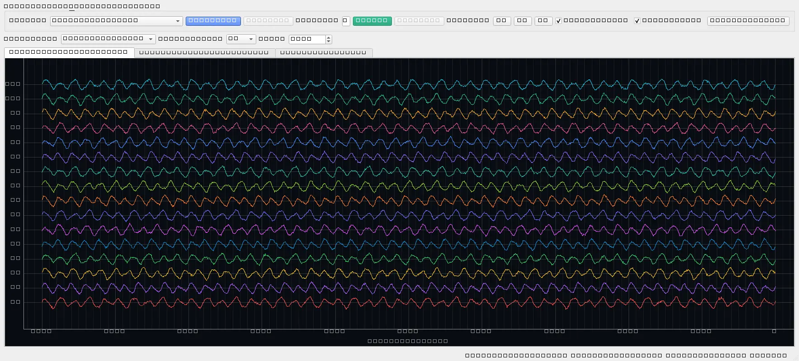 | 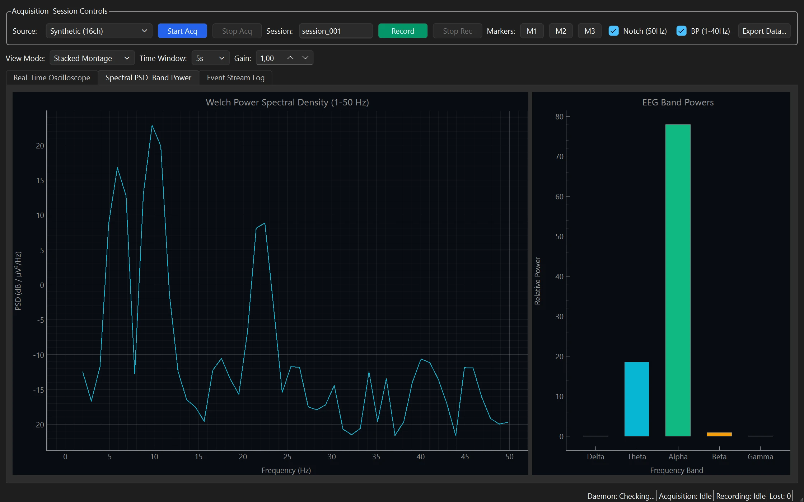 |
| Real-time 16-channel EEG streaming (`SYNTHETIC_BOARD`) with adjustable time scales (2s/5s/10s), gain multipliers, and channel montage labels | Welch Power Spectral Density (1–50 Hz) and real-time power bars for Delta, Theta, Alpha, Beta, and Gamma bands |

### 2. Real-Time Web Dashboard & Visualizer (`neurosyncd`)
High-performance HTML5 Canvas oscilloscope served directly from `neurosyncd` on `http://127.0.0.1:8000/` with binary and JSON WebSockets:

| Real-Time Web Dashboard (All Channels Combined) | Individual Channel Separation Mode |
|:---:|:---:|
| 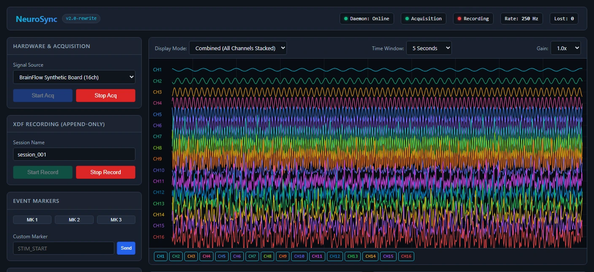 | 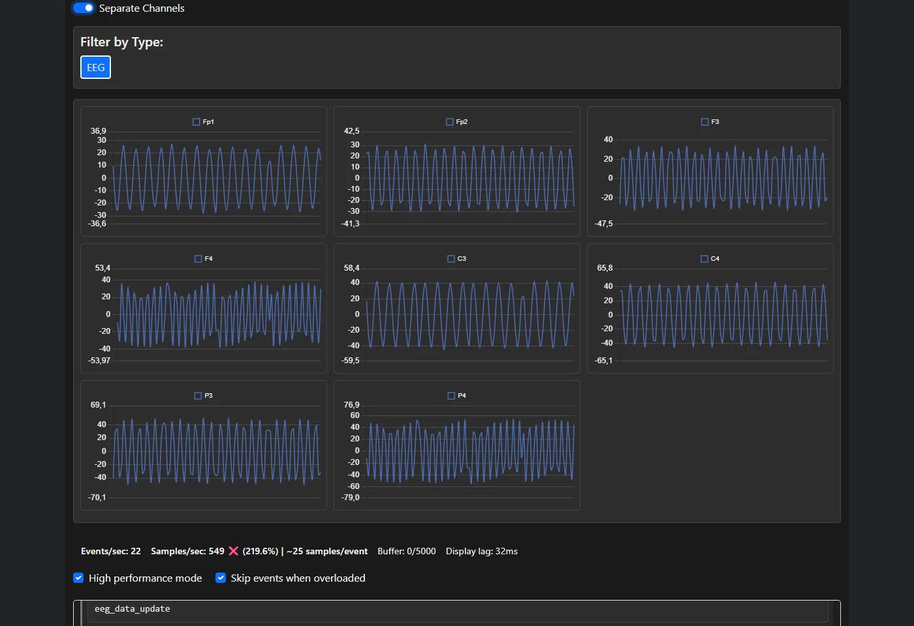 |
| 60 FPS HTML5 Canvas oscilloscope with daemon hardware controls, marker injection, and recording panel | Independent channel strip visualizer isolating individual signal traces |
| **Interactive OpenAPI Documentation** | **Real-Time Synchronized Event Stream** |
| 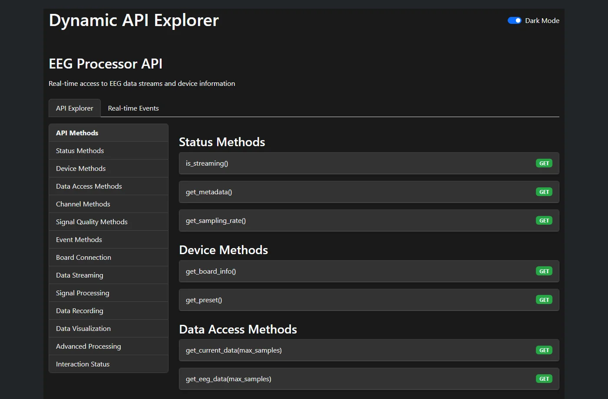 | 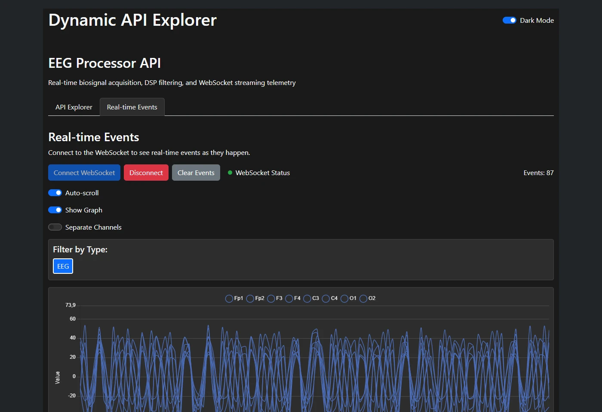 |
| Dynamic endpoint execution and schema inspection | High-throughput WebSocket stream of input events, hardware markers, and EEG chunks |

### 3. Interactive Command Line Interface (`neurosync`)
Command-line client with Rich-rendered tables for terminal-only, remote server, or scripting workflows:

| Typer CLI Daemon Monitoring & Session Control |
|:---:|
| 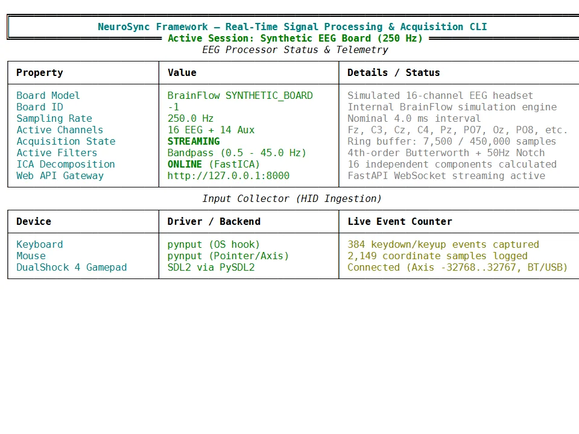 |
| Interactive status checking, background recording control, causal DSP filter configuration, and offline dataset exports |

### 4. Advanced Signal Processing & FastICA Artifact Rejection
CPU-intensive mathematical transformations are offloaded to dedicated background multiprocessing worker pools (`FastIcaProcess`), keeping user interfaces reactive at all times:

| Advanced Processing Configuration Panel | FastICA Component Visualization Dialog |
|:---:|:---:|
| 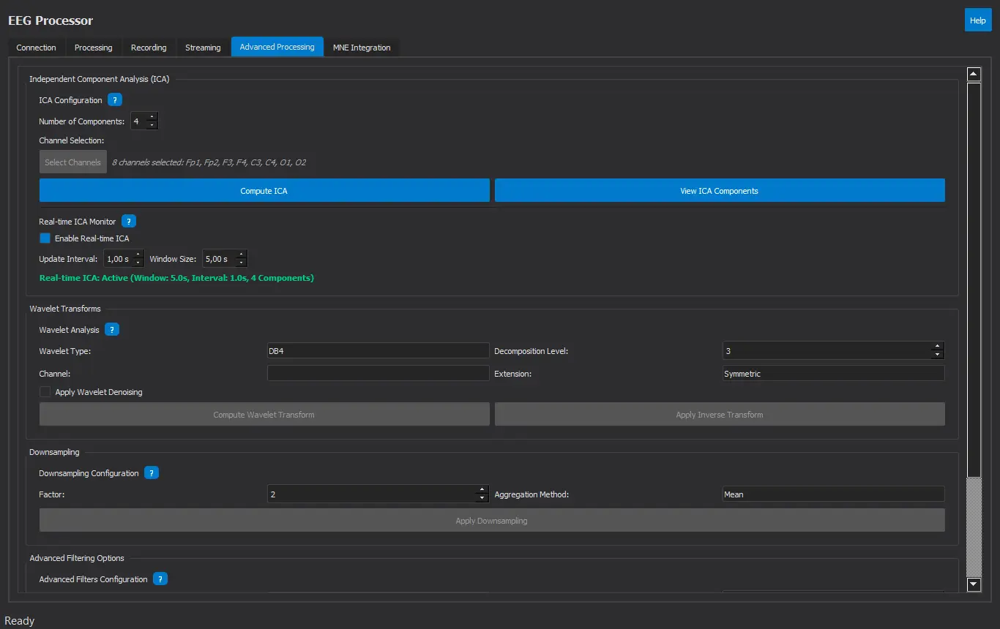 | 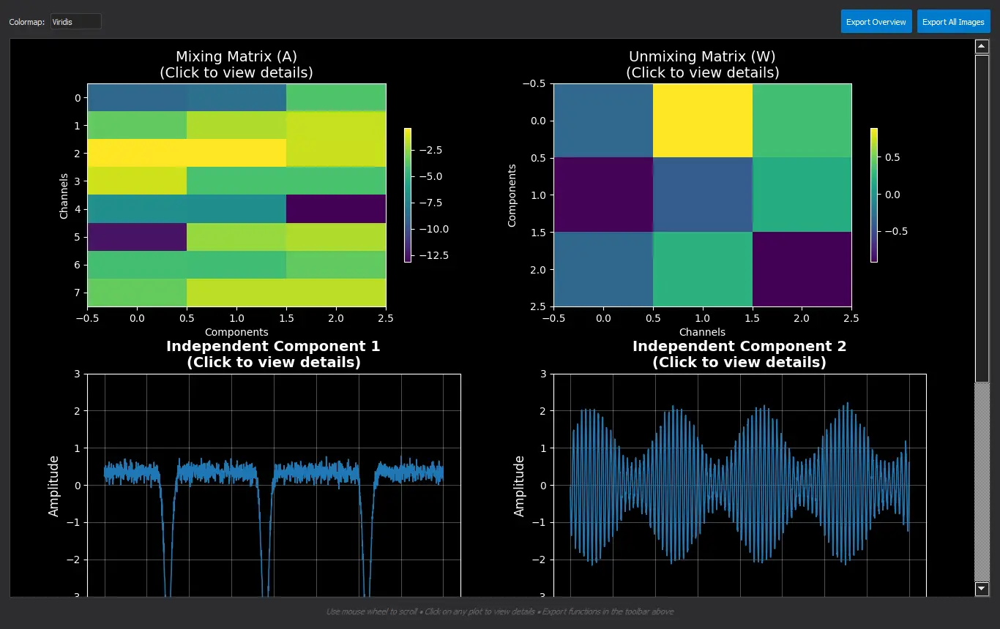 |
| Real-time ICA parameter tuning, Wavelet multiresolution denoising (db4), and Decimation | Interactive component viewer displaying Mixing/Unmixing matrices and independent sources |
| **Standalone ICA Decomposition Render** | **Wavelet & Filter Pipeline** |
| 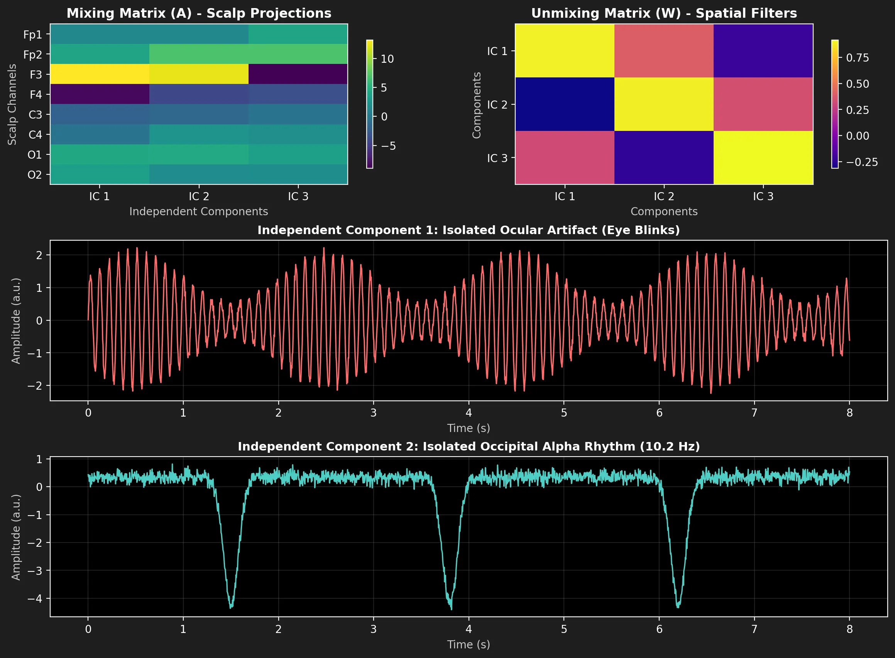 | 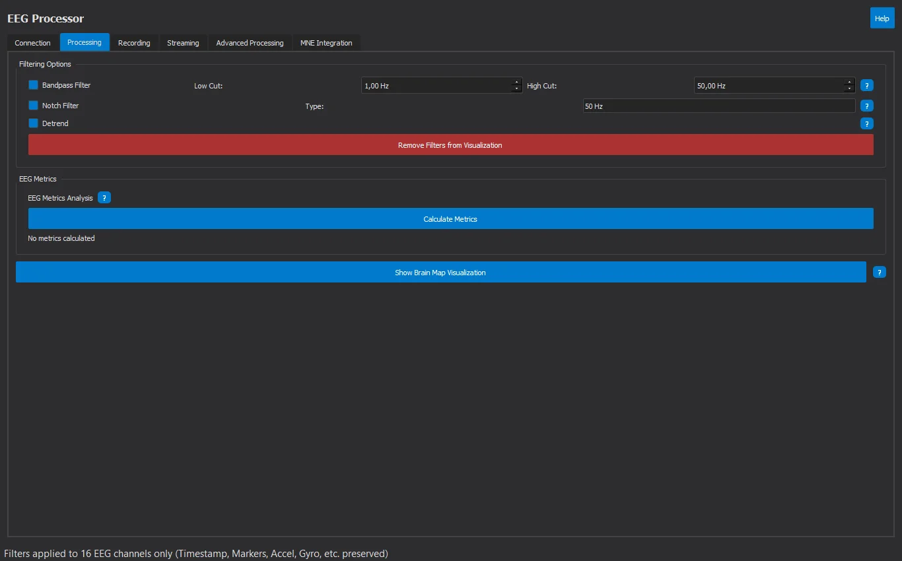 |
| High-resolution separation of ocular blink artifacts and occipital alpha rhythms | Microsecond-latency pipeline combining hardware streaming with mathematical transforms |

### 5. Scientific Spectral Analysis with MNE-Python
The framework bridges raw ring-buffers directly into scientific data structures (`mne.io.RawArray`), enabling high-fidelity spectral and time-frequency transformations:

| Time-Frequency Spectrogram (0.5 – 50 Hz) | Multi-Channel Welch Power Spectral Density (PSD) |
|:---:|:---:|
| 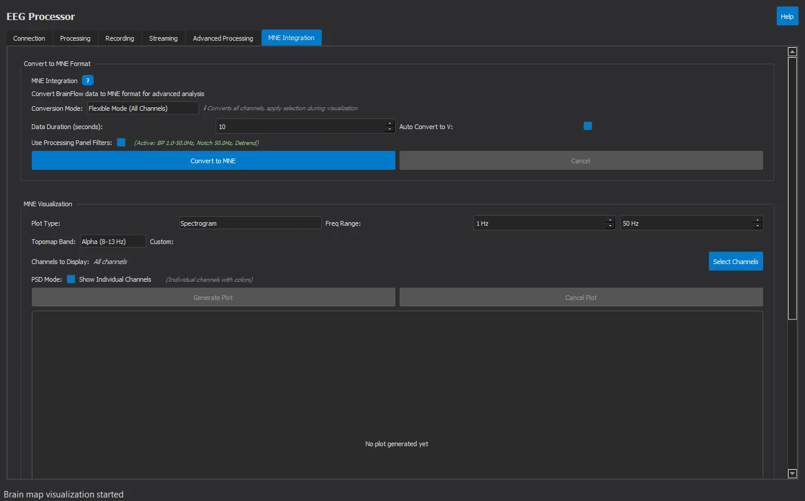 | 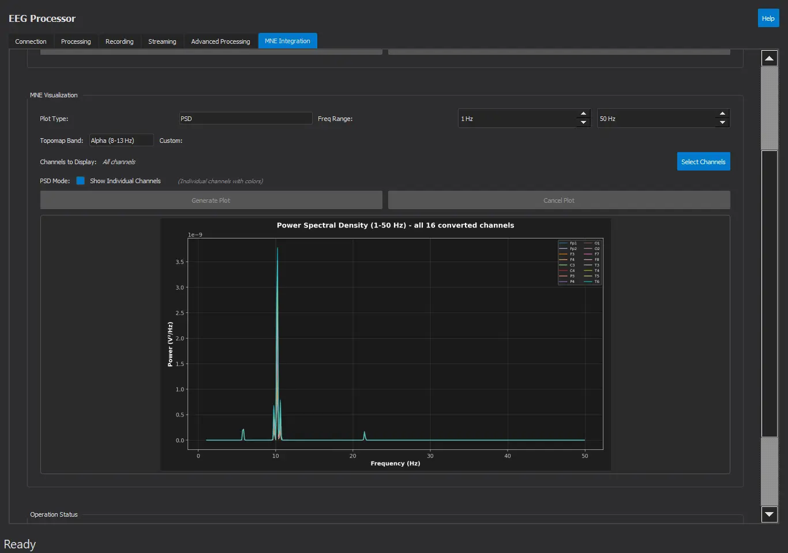 |
| Short-Time Fourier Transform (STFT) spectrogram with Viridis colormap and dB power scale | Individual multi-channel Welch PSD curves across 1–50 Hz with channel legends |
| **Scalp Band-Power Topographical Mapping** | **High-Resolution Spectral Render** |
| 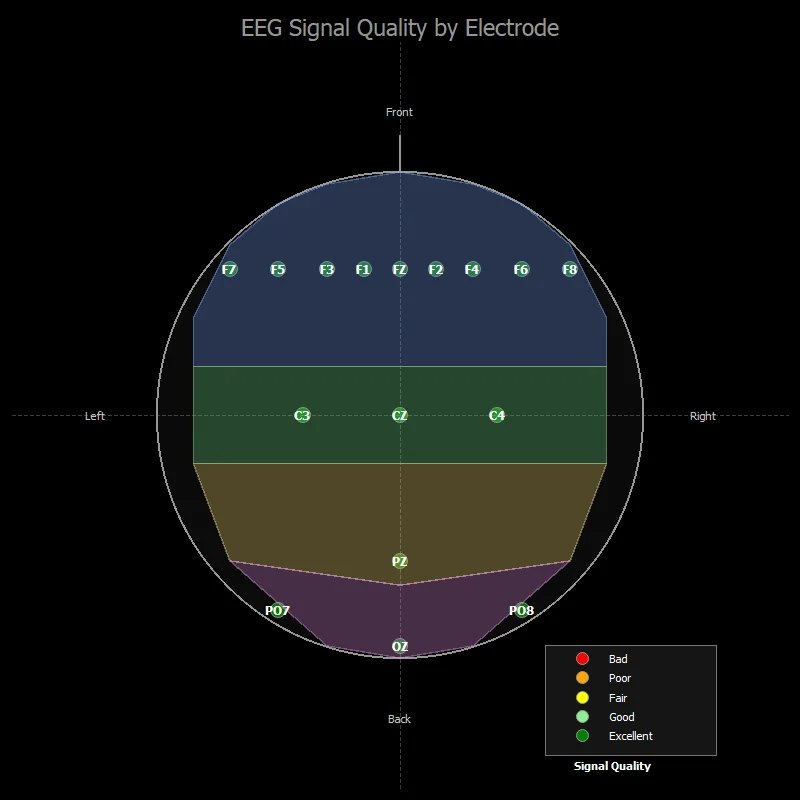 | 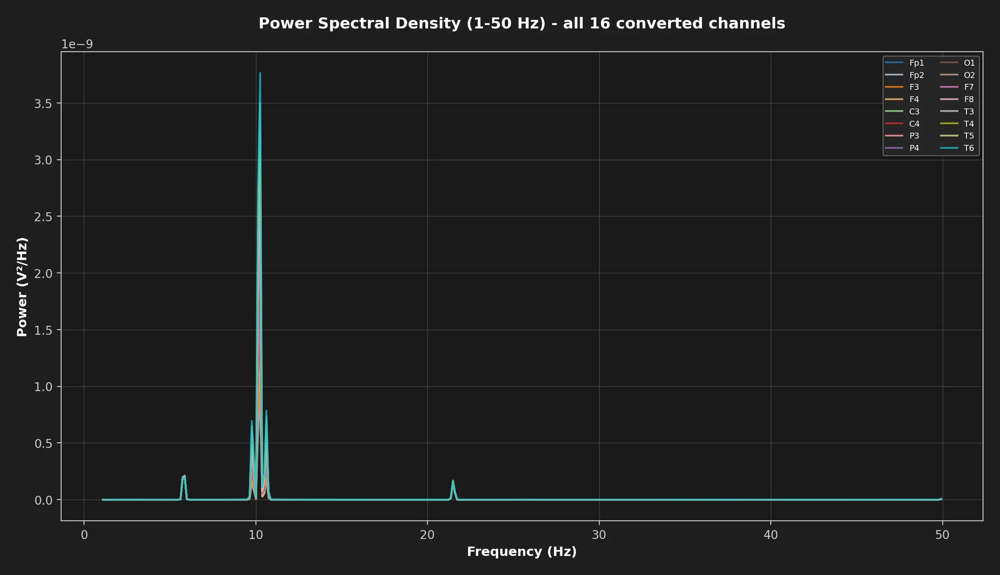 |
| Power distribution mapped across Delta, Theta, Alpha, Beta, and Gamma bands | Welch PSD across 1–50 Hz highlighting alpha peaks (8–12 Hz) |


---

## 🏛️ v2 Architecture & Technical Decisions

The framework follows 17 strict and closed architectural decisions documented in [`docs/decisions.md`](docs/decisions.md):

* **Single Nanosecond Monotonic Clock (D-02):** Outside of precision clock anchoring (`core/anchors.py`), only `Clock.now_ns()` is used.
* **Lossless SPMC Ring Buffer (D-04):** `SignalRing` with sequence counters, seqlock synchronization, and zero silent data drops.
* **Append-Only RAW XDF Recording (D-08):** Continuous in-process streaming to standard XDF files with sidecar metadata.
* **Causal Stateful DSP (D-09):** `scipy.signal.sosfilt` with maintained initial conditions (`zi`).
* **Decoupled Server Daemon (D-10):** `neurosyncd` owns acquisition, causal filtering, and recording without Qt or GUI dependencies.
* **Typed Command Registry (D-11):** Pydantic v2 schemas shared across REST, WebSockets, CLI, and GUI.
* **Standard Offline Exporters (D-08):** Pure-Python exporters for CSV, clinical EDF+ (with TAL annotations), BIDS 1.9+, and NumPy (`.npz`).
* **Modern Desktop GUI (D-12):** PySide6 + pyqtgraph isolated strictly within `neurosync.gui.qt`.

---

## 📚 Technical Documentation & Thesis History

* **[`docs/decisions.md`](docs/decisions.md)**: Formal architectural decisions and rules.
* **[`docs/status.md`](docs/status.md)**: Implementation roadmap and verification criteria.
* **[`docs/history.md`](docs/history.md)**: Chronological development log correlating the 455 thesis commits with the academic report.
* **[`Memoria_Latex/memoria_tfg.pdf`](Memoria_Latex/memoria_tfg.pdf)**: Complete academic manuscript (in Galician) detailing the theoretical foundations, signal processing algorithms, and engineering methodology.
* **[`Diagrams/`](Diagrams/)**: Consolidated architectural diagrams, component charts, and flowcharts in Mermaid and vector PDF formats.

---

## 🔀 Branches

| Branch | Description |
|---|---|
| `main` | Production branch containing the consolidated v2 rewrite (`src/neurosync`), full test suite, academic report (`Memoria_Latex`), and diagrams. |
| [`v2`](https://github.com/PabloSoage/NeuroSync-Framework/tree/v2) | Feature branch for ongoing v2 development and experimental pipelines. |
| `full-history` | Archived branch (`commit 582ec37`) preserving every intermediate commit prior to the final repository cleanup. |

---

## ⚖️ License

Copyright (C) 2026 Pablo Soage Rodas

This program is free software: you can redistribute it and/or modify it under the terms of the **GNU General Public License v3.0** as published by the Free Software Foundation. See the [`LICENSE`](LICENSE) file for full details.
