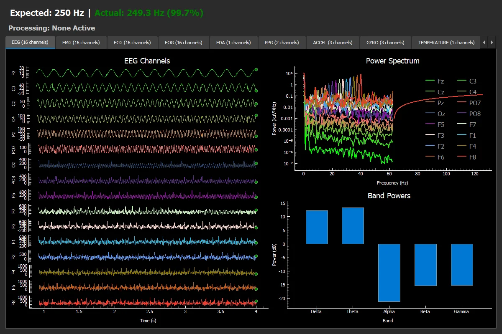
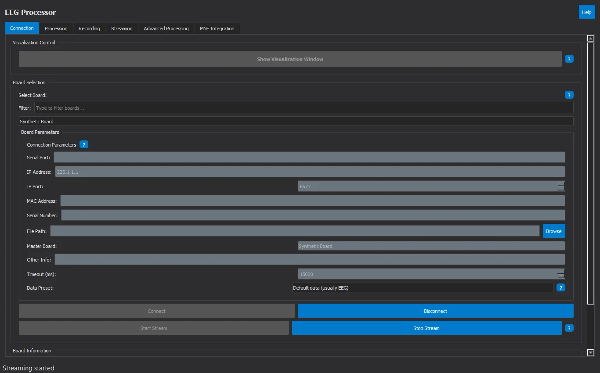
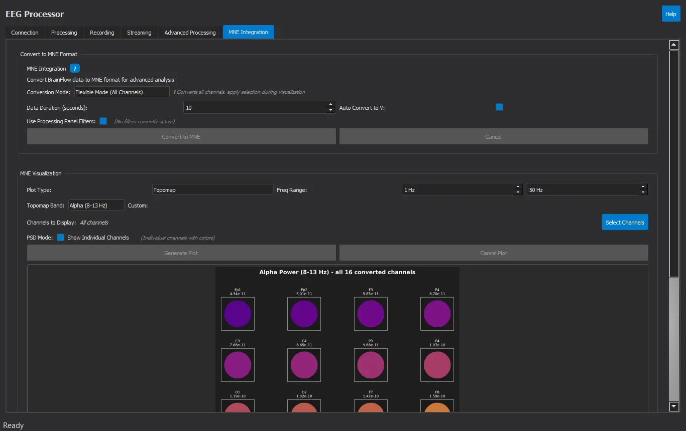
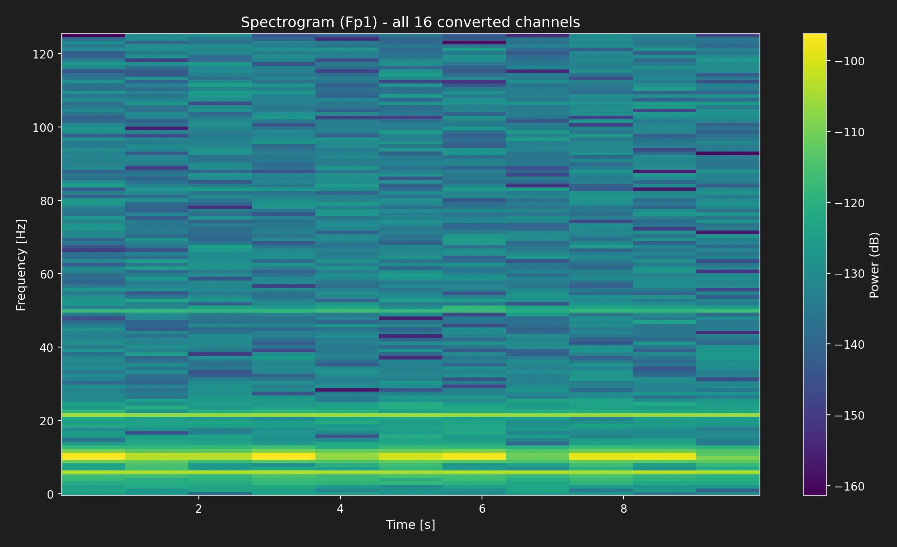
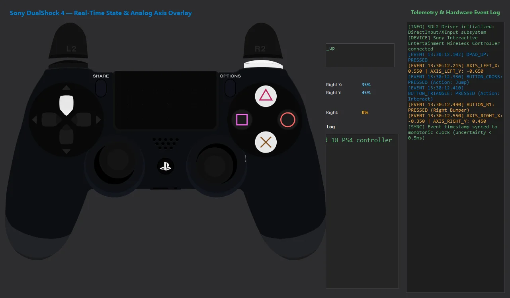
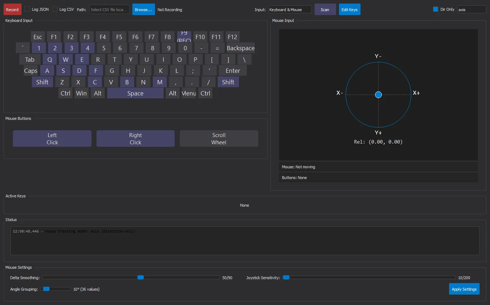

# NeuroSync Framework 🧠⚡

[](https://www.python.org/)
[](https://www.gnu.org/licenses/gpl-3.0)
[]()
[](https://brainflow.org/)
[](https://fastapi.tiangolo.com/)

An open-source software suite developed for the simultaneous capture, real-time digital processing, synchronization, and multi-interface visualization of neurophysiological signals (EEG) and human-interface device (HID) inputs.

Developed as a **Final Degree Project (TFG)** in **Computer Engineering (Computing Specialization)** at Universidade da Coruña (UDC), this framework delivers a modular pipeline for data ingestion from commercial EEG headsets, digital filtering, artifact rejection (FastICA), user interaction tracking, and dynamic streaming over WebSockets and REST APIs.

> **Branch notice:** This branch (`main`) contains the consolidated reference implementation of the Final Degree Project (2025). Active development for the high-performance next-generation rewrite is ongoing in the [`v2`](https://github.com/PabloSoage/NeuroSync-Framework/tree/v2) branch.

---

## 📸 Interface Showcase

All user interfaces run out of the box and can be tested without physical hardware using the built-in synthetic board engine.

### 1. EEG Biosignal Acquisition & Real-Time DSP
| Multi-Channel Waveform Oscilloscope | Digital Filtering & Frequency Tuning |
|:---:|:---:|
|  |  |
| Real-time 16-channel EEG streaming (`SYNTHETIC_BOARD`) with adjustable time scales | IIR bandpass (Butterworth, Chebyshev, Bessel), Notch 50Hz, detrending & SNR metrics |
| **Brain Topomap (10-20 Electrode System)** | **Hardware Connection & Presets** |
|  |  |
| 2D electrode scalp layout with dynamic impedance & signal quality color indicators | Headset device selection, baudrate configuration, and stream initialization |

### 2. Advanced Signal Processing & FastICA Artifact Rejection
CPU-intensive mathematical transformations are offloaded to dedicated background multiprocessing worker pools (`ICAProcessService`), keeping the Qt GUI reactive at all times:

| Advanced Processing Configuration Panel | FastICA Component Visualization Dialog |
|:---:|:---:|
|  |  |
| Real-time ICA parameter tuning, Wavelet multiresolution denoising (db4), and Decimation | Interactive component viewer displaying Mixing/Unmixing matrices and independent sources |
| **Standalone ICA Decomposition Render** | **Wavelet & Filter Pipeline** |
|  |  |
| High-resolution separation of ocular blink artifacts and occipital alpha rhythms | Microsecond-latency pipeline combining hardware streaming with mathematical transforms |

### 3. Scientific Spectral Analysis with MNE-Python
The framework bridges raw BrainFlow ring-buffers directly into `MNE-Python` scientific data structures (`mne.io.RawArray`), enabling high-fidelity spectral and time-frequency transformations:

| Time-Frequency Spectrogram (0.5 – 50 Hz) | Multi-Channel Welch Power Spectral Density (PSD) |
|:---:|:---:|
|  |  |
| Short-Time Fourier Transform (STFT) spectrogram with Viridis colormap and dB power scale | Individual multi-channel Welch PSD curves across 1–50 Hz with channel legends |
| **Scalp Band-Power Topographical Mapping** | **High-Resolution Spectral Render** |
|  |  |
| Multi-electrode spatial band power (Alpha 8–13 Hz, Beta, Theta) with plasma colormap | Direct publication-ready scientific plot exported from the MNE visualizer worker |

### 4. Behavioral HID Ingestion & Gamepads
| Sony DualShock 4 Controller (SDL2) | Keyboard & Mouse Capture |
|:---:|:---:|
|  |  |
| Interactive gamepad visualizer with analog stick tracking & button state overlays | Real-time keydown/keyup listener, mouse delta logging, and microsecond timestamps |

### 5. Remote Streaming & Terminal Environments
| Dynamic Web API Explorer (FastAPI) | Interactive Terminal CLI (Rich & Typer) |
|:---:|:---:|
|  |  |
| Dark-mode browser dashboard with WebSocket telemetry and dynamic API testing | Headless REPL shell with Rich telemetry tables for remote server deployments |

---

## 🏗️ Core Architecture & Modules

The framework is structured as a monorepo comprising four core subsystems designed to operate autonomously or as an integrated pipeline:

```
NeuroSync-Framework/
├── eeg_processor/           # EEG acquisition, DSP, FastICA & PyQt5 GUI
├── input_collector/         # Keyboard, Mouse & PS4 controller capture
├── synchronization_module/  # Experimental unified timeline & export
├── api_explorer/            # Shared FastAPI + WebSocket web dashboard
├── Diagrams/                # Consolidated final architecture diagrams & specs
└── Memoria_Latex/           # Complete academic degree thesis & presentation
```

### 1. EEG Processor (`/eeg_processor`)
Handles real-time biosignal acquisition and digital signal processing (DSP):
* **Hardware Abstraction:** Interfaces through `BrainFlow` to communicate with research and consumer headsets (e.g., g.tec Unicorn, OpenBCI, Muse), as well as a synthetic generator (`SYNTHETIC_BOARD`).
* **Digital Signal Conditioning:** Implements configurable IIR filters (Butterworth, Chebyshev, Bessel), notch filters (50/60 Hz), and wavelet decomposition.
* **Multiprocessing Isolation:** Offloads CPU-bound algorithms—such as FastICA (Independent Component Analysis) artifact rejection and `MNE-Python` continuous PSD/topomap generation—into independent OS worker processes (`multiprocessing`), ensuring the GUI thread never drops frames.

### 2. Input Collector (`/input_collector`)
Tracks and logs behavioral interaction data with microsecond-level polling:
* **Multi-Device Tracking:** Asynchronously captures keyboard and mouse events (`pynput`) as well as Sony PlayStation 4 (DualShock 4) gamepads (via SDL2 event loops using `pysdl2` and `pysdl2-dll`).
* **Normalized Event Engine:** Dispatches unified event payloads (`timestamp`, `device_id`, `event_type`, `state`) agnostic of the physical hardware source.

### 3. Web API Explorer (`/api_explorer`)
A high-throughput web gateway serving real-time telemetry to browsers and external clients:
* **Dynamic Endpoint Discovery:** Auto-registers endpoints exposed by active modules at runtime.
* **Worker Pool Architecture:** Efficient WebSocket client pool management with `orjson` serialization and batch buffering for low-latency transmission.
* **Interactive Dashboard:** Built-in web interface featuring dark mode, dynamic method invocation forms, real-time event logs, and `Chart.js` signal streaming.

### 4. Synchronization Module (`/synchronization_module`) - *Experimental*
An integration layer unifying asynchronous EEG samples and HID event streams into a single synchronized timeline:
* **Clock Alignment:** Leverages Lab Streaming Layer (LSL) concepts to reconcile clock offsets between hardware clocks.
* **Standard Scientific Export:** Exports synchronized recording sessions to standard formats (CSV, HDF5 via `h5py`/`tables`, and BIDS / EDF+ structures).

---

## 🖥️ Multi-Interface Architecture

To ensure operational flexibility across experimental laboratories, server environments, and remote monitoring stations, the framework provides three distinct interface layers:

1. **Native Desktop GUI (PyQt5):** Panel-based desktop application providing multi-signal oscilloscopes, 10-20 system Brain Topomaps, live filter frequency tuning, and gamepad button overlays.
2. **Interactive CLI (Typer & Rich):** Headless terminal interface featuring an interactive command REPL (`start-stream`, `apply-filters`, etc.) and live Rich telemetry tables for server deployments.
3. **Web API & Explorer (FastAPI):** Dynamic REST and WebSocket server with interactive dashboard and Chart.js signal plotting.

---

## ⚙️ Quick Start

### Prerequisites
* **Python 3.11** (Recommended)
* PS4 controller support uses SDL2 via `pysdl2` and `pysdl2-dll` (installed automatically from `requirements.txt`).

### Installation
Clone the repository and set up a virtual environment:

**Windows (PowerShell / CMD):**
```powershell
python -m venv .venv
.\.venv\Scripts\activate
pip install -r requirements.txt
```

**Linux / macOS:**
```bash
python3 -m venv .venv
source .venv/bin/activate
pip install -r requirements.txt
```

---

### Launching the Modules

You can launch the core modules independently with custom interface flags:

```bash
# 1. Launch the EEG Processor (Desktop GUI)
python eeg_processor/run.py

# 2. Launch the Input Collector (Desktop GUI + CLI shell side-by-side)
python input_collector/run.py --cli

# 3. Launch in Headless mode with the FastAPI Web Explorer enabled
python eeg_processor/run.py --no-gui --enable-web-api --api-port 8000

# 4. (Experimental) Launch the unified synchronization application
python synchronization_module/run.py
```

### 🧪 Testing Without Physical Hardware (Synthetic Mode)

You do not need a physical EEG headset or gamepad to test the entire system:
1. Run `python eeg_processor/run.py`.
2. In the **Connection** panel, select **Synthetic Board** (`BrainFlow BoardIds.SYNTHETIC_BOARD`).
3. Click **Connect**, then **Start Stream**, and click **Show Visualization Window**.
4. The multi-signal oscilloscope will immediately plot 16 channels of simulated EEG waves in real time.
5. In another terminal, run `python input_collector/run.py` to test keyboard and mouse tracking.

---

## 📚 Technical Documentation & Diagrams

Comprehensive documentation is provided in the repository:
* **[`Memoria_Latex/memoria_tfg.pdf`](Memoria_Latex/memoria_tfg.pdf)**: Complete academic manuscript (in Galician) detailing the theoretical foundations, signal processing algorithms, and engineering methodology.
* **[`Diagrams/`](Diagrams/)**: Consolidated architectural diagrams, component charts, and flowcharts in Mermaid (`.md`) and vector `.pdf` format for each module (`ApiExplorer`, `EegProcessor`, `InputCollector`), along with their respective technical specifications (`README_en.md`, `README_es.md`).

---

## ⚠️ Known Limitations

This branch represents the code as delivered for the Final Degree Project (2025). A later technical review identified the following constraints:

* **Synchronization is experimental:** The integrated synchronization module stamps EEG chunks and input events with `time.time()` upon arrival rather than using hardware clock corrections. On Windows, `time.time()` advances in discrete steps of ~15.6 ms. The academic report lists EDF+/HDF5/BIDS exports and advanced clock synchronization as future work.
* **Long recording sessions:** Signal acquisition reads using `get_current_board_data()`, which does not drain BrainFlow's internal ring buffer. With default buffer sizes, stream updates halt after ~30 minutes at 250 Hz.
* **Filter re-transmission:** Applying digital filters during an active recording re-emits the 30-second display buffer to consumers, which can cause duplicated samples in naive recording listeners.
* **Web API loopback:** The FastAPI server is designed for local laboratory use without authentication; do not expose it beyond `127.0.0.1`.

*These architectural limitations are directly addressed in the [`v2`](https://github.com/PabloSoage/NeuroSync-Framework/tree/v2) rewrite.*

---

## 🔀 Branches

| Branch | Description |
|---|---|
| `main` | Final reference code of the Final Degree Project, academic report (`Memoria_Latex`), final consolidated diagrams, and documentation. |
| [`v2`](https://github.com/PabloSoage/NeuroSync-Framework/tree/v2) | Next-generation rewrite: unified installable package (`src/neurosync`), monotonic nanosecond clock, lock-free ring buffers, XDF recording, headless core, and Qt 6 GUI. |
| `full-history` | Archived branch (`commit 582ec37`) preserving every intermediate diagram, draft, and commit prior to the final repository cleanup. |

---

## ⚖️ License

Copyright (C) 2026 Pablo Soage Rodas

This program is free software: you can redistribute it and/or modify it under the terms of the **GNU General Public License v3.0** as published by the Free Software Foundation. See the [`LICENSE`](LICENSE) file for full details.
